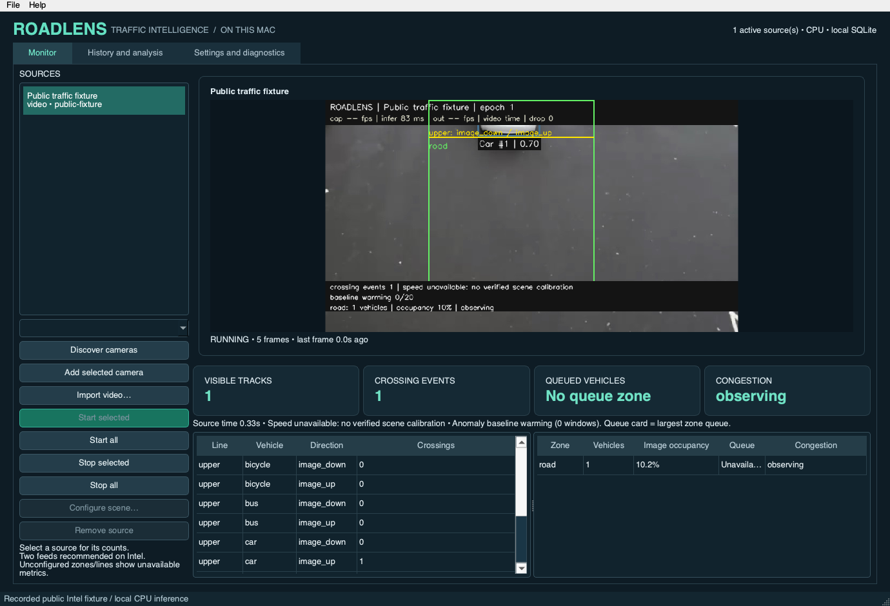
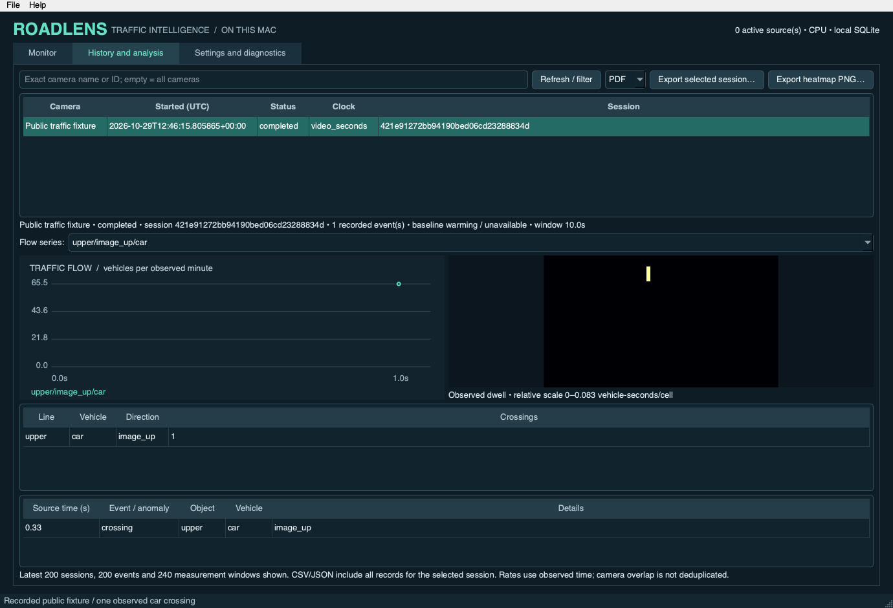
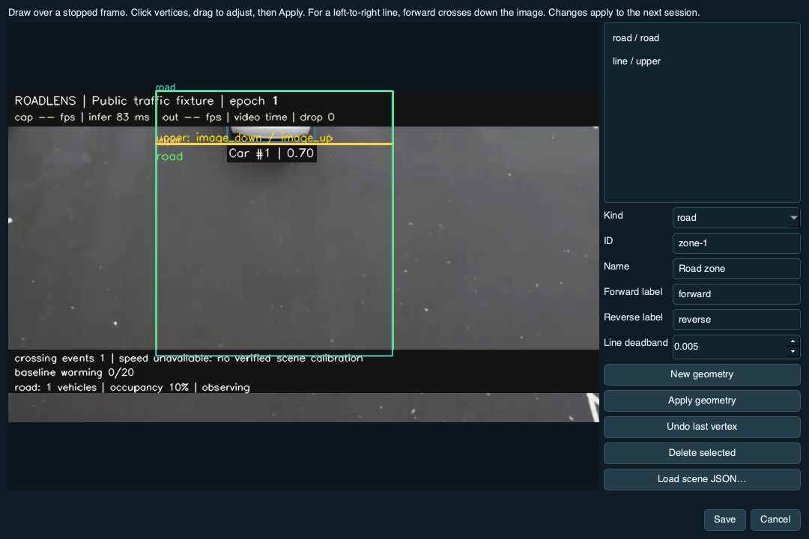

# ROADLENS

**Local vehicle detection and traffic intelligence for macOS.**

ROADLENS turns a MacBook camera, an available iPhone Continuity Camera, or a
recorded video into annotated vehicle tracks and traffic measurements. It runs
on your Mac using OpenCV DNN, ByteTrack, PySide6 and SQLite. No cloud inference,
web server, application account or telemetry is required.

Built for **Intel macOS 14+**, with conservative defaults for a 16 GB MacBook Pro.
ROADLENS is an early-stage research and analysis tool; counts depend on the
scene, sampling, occlusion and calibration. It is not a certified traffic or
speed-enforcement system. Apple Silicon has not been validated.

[Install](#installation) · [Usage](#usage) · [Architecture](#architecture) ·
[Contribute](CONTRIBUTING.md) · [Security](SECURITY.md) · [License](LICENSE)

## Features

| Capability | What it provides |
| --- | --- |
| Native desktop | Simultaneous source previews, camera settings, diagnostics and session history |
| Local vision | YOLOv8n COCO detection of cars, motorcycles, buses, trucks and bicycles; class-aware tracking and motion overlays |
| Camera identity | AVFoundation discovery, stable device IDs, Continuity Camera support and reconnect handling |
| Scene configuration | Interactive road/lane/queue/exclusion polygons, finite counting lines and JSON scene import |
| Traffic intelligence | Directional crossing counts, image occupancy, persistent queues, congestion, stalls and statistical anomalies |
| Analysis | Measured flow charts, trajectories and observed vehicle-dwell heatmaps |
| Local records | SQLite sessions with scene/settings snapshots; PDF summaries and CSV/JSON exports |
| CLI and verification | Headless processing, diagnostics and reviewed-footage accuracy checks alongside the desktop |

## Screenshots

These are actual application captures generated from the licensed **public Intel
recording fixture**. They show recorded-video inference, not a live camera or
simulated traffic. No private recording, local path or device ID is included.





<details>
<summary>Interactive scene editor</summary>



</details>

Attribution and reproduction: [public fixtures](assets/README.md),
[screenshot script](scripts/capture_screenshots.py),
[reviewed asset hashes](docs/public-assets.json).

## Installation

### Run from source

Requirements: Intel macOS 14+, Python **3.11–3.14**, and Apple Command Line Tools
(`xcode-select --install` if not already installed). Clone the source repository, then run:

```sh
git clone https://github.com/siddhantkrishna/roadlens.git
cd roadlens
python3 -m venv .venv
source .venv/bin/activate
python -m pip install -e .
roadlens fetch-model
roadlens-desktop
```

`fetch-model` is an explicit network operation: it downloads a pinned YOLOv8n
ONNX export over HTTPS and checks its SHA-256. Weights are not committed to this
repository. Normal inference and analysis work offline after setup. Read the
[model license and provenance notes](docs/MODEL_PROVENANCE.md) before use/distribution.

For the exact Intel/Python 3.14 environment used in verification:

```sh
python -m pip install -r requirements-macos-intel.lock
python -m pip install --no-deps -e .
```

### Build the macOS app locally

```sh
python -m pip install -e '.[build]'
python scripts/build_app.py
open dist/ROADLENS.app
```

The bundle contains Python, Qt, the model and the native camera helper. The
installed app needs no Python environment or compiler. For personal installation,
quit it, then drag `dist/ROADLENS.app` to `/Applications`. User data lives outside
the bundle. Local builds are ad-hoc signed and are not notarized.

**Public binary releases are gated:** the current third-party model export's
editable source/export provenance must be established before redistributing the
app or weights. This repository prepares a source release; it does not claim a
cleared public binary download. See [licensing](docs/LICENSING.md) and
[release preparation](docs/RELEASING.md).

## Usage

### Desktop

1. Open `roadlens-desktop` (or `python -m roadlens.desktop`).
2. Choose **Discover cameras**, add the actual available device, then **Start**;
   or choose **Import video** to analyze a local recording.
3. Stop on a useful frame and choose **Configure scene**. Draw polygons or a
   counting line, set its labels, then Apply or Save. Start a new session to use it.
4. Select a source for its live counts and zone statistics. Open **History and
   analysis** for saved sessions, flow series, events/anomalies and heatmaps.
5. Select a saved session and export PDF, CSV or JSON. Settings apply between
   sessions; diagnostics explain source failures and measured processing rates.

No geometry is inferred automatically. Counting needs a configured line;
physical speed needs a verified, measured calibration. Overlapping cameras and
zones are not combined into a global unique-vehicle count. Imported recordings
process every frame without pacing by default; TOML can select paced playback.

### Camera permissions and iPhone

Accept the macOS camera prompt when capture starts. If denied, enable ROADLENS /
ROADLENS Camera (or the launching terminal) in **System Settings → Privacy &
Security → Camera**, then restart capture.

For iPhone, enable **Settings → General → AirPlay & Continuity → Continuity
Camera**. Use the same Apple Account with two-factor authentication; enable
Wi-Fi and Bluetooth, and keep the phone nearby, locked and mounted, or connect a
trusted USB cable. macOS determines whether the camera is available. See
[Apple's setup instructions](https://support.apple.com/en-us/102546).

### Command line

```sh
roadlens doctor
roadlens cameras
roadlens run --camera default
roadlens run --camera default --camera 'iPhone'
roadlens run --video assets/traffic.avi --offline --headless \
  --scene assets/traffic.scene.json --database data/traffic.sqlite3
roadlens report --database data/traffic.sqlite3
roadlens export --database data/traffic.sqlite3 --format json --output-dir artifacts/json
roadlens export --database data/traffic.sqlite3 --format csv --output-dir artifacts/csv
```

The bundled scene is specific to that public clip. For your own camera, create a
scene with `roadlens scene init my-road.json` and validate it with
`roadlens scene check my-road.json`, or use the desktop editor. Copy
[roadlens.example.toml](roadlens.example.toml) to an ignored `roadlens.toml` for
multiple sources. `roadlens run --config roadlens.toml` retains the original CLI.

Detailed guides: [desktop and packaging](DESKTOP.md),
[traffic models, calibration and metrics](TRAFFIC.md),
[verification and limitations](VERIFICATION.md), [audit repairs](docs/AUDIT.md),
[release notes](docs/RELEASE_NOTES.md).

## Architecture

```text
AVFoundation helper / OpenCV video reader
    → one-frame capture slot (backpressure or newest frame)
    → per-source CPU detector + class-aware ByteTrack worker
    → traffic service → validated scene + analyzer → SQLite connection
    → one-frame result slot → PySide6 main-thread preview and live statistics

SQLite → separate history/export workers → charts, heatmaps, PDF / CSV / JSON
```

| Location | Responsibility |
| --- | --- |
| `src/roadlens/native/`, `cameras.py`, `capture.py` | Camera discovery/identity, AVFoundation helper, bounded capture, video decoding and reconnects |
| `detection.py`, `tracking.py`, `pipeline.py` | ONNX preprocessing/inference, per-class tracking, motion and worker lifecycles |
| `traffic/scene.py`, `analyzer.py`, `statistics.py` | Validated geometry, crossing/queue/congestion logic and baseline anomalies |
| `traffic/service.py`, `store.py` | Session snapshots, per-worker SQLite connections, persistence, retention and exports |
| `desktop.py`, `desktop_widgets.py`, `desktop_data.py` | Qt controls, scene editor, native charts, read-only history queries and PDF generation |
| `cli.py`, `preview.py` | Existing command line and OpenCV preview |

Defaults: 1280×720 camera request at 15 FPS, 640 model input, 8 inference FPS per
source and two OpenCV threads. These are caps/requests, not performance promises.
Two feeds are a reasonable starting point on Intel; reduce rates/resolution if
CPU load or thermals require it. Each source has its own detector/tracker and
bounded frame slots. Tracking IDs reset across reconnects/gaps and do not identify
physical vehicles across sessions or cameras.

## Data and privacy

Desktop preferences, logs, scenes and the default SQLite database live under
`~/Library/Application Support/ROADLENS`. The existing default retention is seven
days; finalized sessions older than retention are pruned when analysis starts.
Export important history before reducing retention. The database is local and
is not encrypted at rest.

Frames stay in memory unless an explicit snapshot/export is requested. Source
names, device IDs, file paths, trajectories and logs can still be sensitive.
Exclusion zones remove analytics observations; they do not redact preview pixels.
Recordings, databases, secrets, model weights, environments, generated apps and
exports are excluded from the public source payload. See [SECURITY.md](SECURITY.md).

## Development and testing

```sh
python -m pip install -e '.[dev,security]'
roadlens fetch-model
QT_QPA_PLATFORM=offscreen python -m pytest -q
ruff check src tests scripts
ruff format --check src tests scripts
python scripts/check_release.py
bandit -r src scripts -ll -ii
pip-audit -r requirements-macos-intel.lock --no-deps --disable-pip --timeout 60
python -m pip check
```

Tests cover real recorded-video/ONNX inference, capture backpressure, tracking,
scene validation, directional counts, traffic metrics, SQLite persistence and Qt
integration. Missing weights cause model tests to skip; tests never download
weights. The camera test is opt-in and excluded from CI. Recorded/mocked tests
are not physical-camera validation. CI definitions are provided; hosted CI status must be checked on [GitHub Actions](https://github.com/siddhantkrishna/roadlens/actions).
The manual packaging workflow verifies a bundle on an ephemeral Intel runner and
uploads no model or binary.

See [CONTRIBUTING.md](CONTRIBUTING.md) for setup, pull requests, regression tests
and safe fixture handling. Before a public push, follow [RELEASING.md](docs/RELEASING.md).

## License and acknowledgements

ROADLENS original work is **AGPL-3.0-only**. See [LICENSE](LICENSE) and
[NOTICE](NOTICE). Ultralytics YOLO models retain upstream AGPL/commercial terms;
using ONNX/OpenCV does not remove those terms. Qt and other dependencies have
separate redistribution obligations. The Intel fixture is CC BY 4.0; the bus
photograph retains Ultralytics attribution. See [licensing](docs/LICENSING.md),
[third-party notices](THIRD_PARTY.md) and [fixture provenance](assets/README.md).
